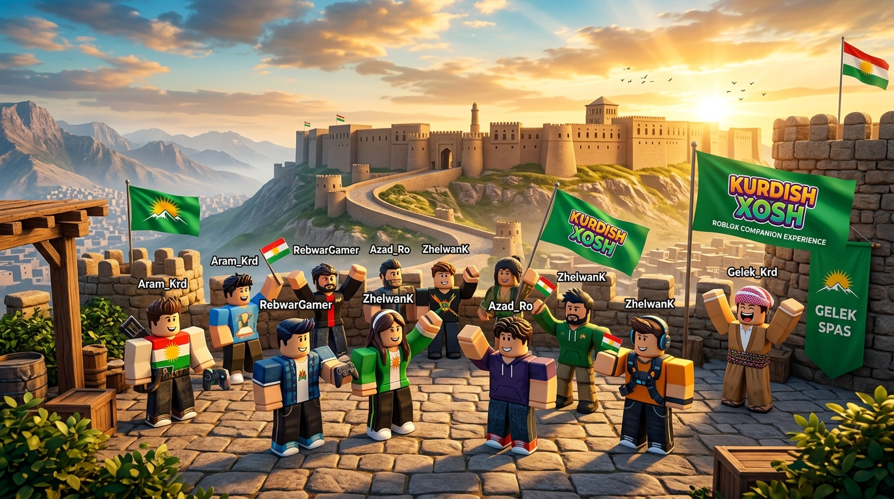

# Kurdish Xosh Web and Xosh Chat



**Kurdish Xosh Web and Xosh Chat** is a dual-component platform designed for the popular Roblox gaming experience **Kurdish Xosh**:

1. **Kurdish Xosh Web**: A modern, green-themed web portal explaining the game, the companion application, and live **KDID Server Rooms**.
2. **Xosh Chat App**: A companion mobile application featuring a floating chat bubble, unique persistent player App IDs (`KX-ID-XXXXX`), customizable profiles, and trilingual communication in **Kurdish Sorani (سۆرانی)**, **English**, and **Arabic**.

---

## 🌟 Core Architecture & Features

### 1. Kurdish Xosh Web
- **Modern Green-and-White Design**: High visual polish tailored to Kurdish gaming culture with authentic Citadel imagery and sun emblem.
- **Trilingual & Native RTL Support**: Seamless Kurdish Sorani (`ckb`), English (`en`), and Arabic (`ar`) with right-to-left layout flipping.
- **Honest Download System**: Instant Progressive Web App (PWA) installation from the browser with no deceptive or fake download links.
- **KDID Room Explorer**: Live list of official and custom gaming servers (`KDID-1824`, `KDID-5501`, `KDID-9042`).

### 2. Xosh Chat Mobile Companion
- **Floating Chat Bubble**: Minimizable, draggable floating bubble that remains accessible while playing.
- **Fallback In-App Chat**: When floating overlays are unsupported (e.g. mobile browsers without system overlay permission), it automatically provides a clean in-app interface.
- **Unique App ID & Custom Profiles**: Each user receives a unique persistent App ID (e.g., `KX-ID-88392`) and can set their custom username and profile picture.
- **Sender Identification**: Every message displays the sender's username, profile avatar, role badge (`Host`, `VIP`, `Player`), and App ID.

### 3. KDID Server Rooms
- **Synchronized Session Rooms**: Players enter server codes (such as `KDID-1824`) displayed inside the Roblox game HUD to chat together.
- **Anti-Impersonation Protection**: Messages are cryptographically bound to session authentication tokens and persistent App IDs.
- **Safety, Filtering & Moderation**: Server-enforced rate limiting (1.5s delay), profanity masking with `###`, abuse reporting modal, and user blocking.

---

## 🚀 Beginner's Guide: Publishing on GitHub Pages

You can host **Kurdish Xosh Web** for free on GitHub Pages:

### Step 1: Install `gh-pages`
```bash
npm install gh-pages --save-dev
```

### Step 2: Configure `vite.config.ts`
Set the `base` property to match your GitHub repository name:
```typescript
export default defineConfig({
  base: '/kurdish-xosh-web/',
  // ... rest of plugins
});
```

### Step 3: Add Deploy Scripts to `package.json`
```json
"scripts": {
  "predeploy": "npm run build",
  "deploy": "gh-pages -d dist"
}
```

### Step 4: Deploy to GitHub Pages
```bash
npm run deploy
```
Your website will be live at `https://YOUR_USERNAME.github.io/kurdish-xosh-web/`.

---

## 📱 Android Production Permissions & Overlay Architecture

To package Xosh Chat as a native Android APK (via Capacitor or Flutter), the following permissions are configured in `android/app/src/main/AndroidManifest.xml`:

```xml
<!-- 1. Floating Chat Bubble System Overlay -->
<uses-permission android:name="android.permission.SYSTEM_ALERT_WINDOW" />

<!-- 2. Notifications for Game Session Invites -->
<uses-permission android:name="android.permission.POST_NOTIFICATIONS" />

<!-- 3. Network Access for KDID Room Sync -->
<uses-permission android:name="android.permission.INTERNET" />

<!-- 4. Foreground Service for Overlay Lifecycle -->
<uses-permission android:name="android.permission.FOREGROUND_SERVICE" />
<uses-permission android:name="android.permission.FOREGROUND_SERVICE_SPECIAL_USE" />
```

> **Google Play Store Policy Note**: The `SYSTEM_ALERT_WINDOW` permission requires explicit user consent through Android's "Display over other apps" settings. If permission is denied or unsupported, Xosh Chat automatically falls back to the in-app chat interface.

---

## 🛡️ Roblox Creator Hub Compliance

- **No Unauthorized Injection**: Xosh Chat does **NOT** hook into Roblox executable memory or bypass platform communication restrictions.
- **TextChatService Compliance**: Messages synchronized with the Roblox experience pass through server-side moderation and respect Roblox's safety policies.
- **Demonstration Mode**: For local prototyping and testing, Xosh Chat connects to a verified demo server with simulated Kurdish players.

---

## 💻 Local Development

1. Install dependencies:
   ```bash
   npm install
   ```
2. Start the full-stack server (Express backend + Vite client):
   ```bash
   npm run dev
   ```
3. Open [http://localhost:3000](http://localhost:3000) in your browser.
